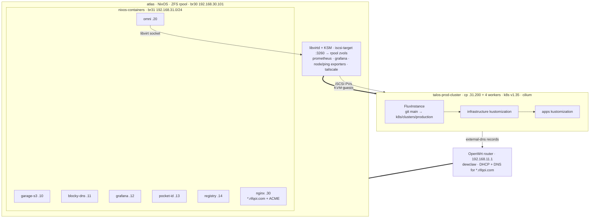

# NixOS + Omni + Talos + Flux GitOps Homelab

One repo rebuilds the whole lab: the OpenWrt router, the NixOS server it
fronts, seven nixos-containers on that server, and the Talos Kubernetes
cluster running on its VMs. `hosts/` and `modules/` are the NixOS side,
`k8s/` is the cluster, and Flux reconciles `k8s/clusters/production`
from `main`.



## Repo map

- `flake.nix`: `nixosConfigurations` for `atlas` (x86_64, the server) and
  `vm` (aarch64 test box), a deploy-rs node for atlas, the dev shell, and
  apps wrapping the iSCSI recovery scripts.
- `hosts/atlas`, `hosts/vm`, `hosts/openwrt`: per-machine configs. OpenWrt
  is router config as Nix, built by dewclaw.
- `modules/`: feature-flagged modules under `features.*` (containers,
  monitoring, storage, networking, virtualization) plus `common/` for the
  shared base.
- `grafana/`: dashboard JSONs provisioned into Grafana.
- `k8s/omni`: cluster template and libvirt machine classes.
- `k8s/helm`: helmfile that installs Cilium before Flux exists.
- `k8s/clusters/production`: the FluxInstance plus the `infrastructure` and
  `apps` Flux Kustomizations.
- `diagnostics/`: runbooks for failures that already happened.
- `secrets/` and `*.enc.yaml`: sops/age. Root `.sops.yaml` covers NixOS and
  container secrets; `k8s/clusters/production/.sops.yaml` covers Flux
  manifests decrypted in-cluster by `sops-age`.

## Components

### atlas — host services

- **libvirtd + KSM** runs the Talos guests (host carries ~28GiB of VMs on
  31GiB RAM; KSM dedupes the near-identical Talos images).
- **iscsi-target** (`targetcli`, port 3260) serves ZFS zvols as the
  cluster's PVCs. `saveconfig.json` is backed up hourly and restored before
  the service starts; `modules/storage/iscsi.nix` also autostarts the
  `talos-*` libvirt domains only after iSCSI is up.
- **prometheus + grafana + node-exporter + ping-exporter** (`features.monitoring`)
  scrape the host, the router, and a VM over Tailscale. Prometheus keeps
  7d and runs the remote-write receiver.
- **tailscale**: MagicDNS on; reaches the off-LAN scrape targets.
- **e1000e watchdog**: TSO stays off on `eno2`, and a 5-minute-cooldown
  timer restarts `network-setup` after a transmit-queue stall.
- **openwrtDnsRecords**: a path unit watches `/run/current-system` and
  upserts every container's DNS records into the router over the LuCI RPC
  on each rebuild.
- **ACME** via Cloudflare dns-01; certs land in `/var/lib/acme` and are
  bind-mounted into the containers that need them.

### atlas — nixos-containers (`modules/container/`)

| container | br31 IP | runs |
| --- | --- | --- |
| `garage-s3` | .10 | Garage S3 storage on the `rpool/garage` dataset |
| `blocky-dns` | .11 | Blocky DNS |
| `grafana` | .12 | Grafana with the dashboards from `grafana/` |
| `pocket-id` | .13 | Pocket ID, the OIDC issuer for the apiserver and headlamp |
| `registry` | .14 | OCI registry (`registry.rifqoi.com`) for the self-built images |
| `omni` | .20 | Omni + the libvirt infra provider (podman); drives host libvirtd over the bind-mounted socket and provisions the Talos VMs |
| `nginx` | .30 | Reverse proxy for `*.rifqoi.com` |

### talos-prod-cluster — infrastructure (`k8s/clusters/production/infrastructure`)

| dir | component |
| --- | --- |
| `kgateway` | shared `Gateway` for `*.rifqoi.com`: TLS wildcard cert, http→https redirect, websocket/timeout/access-log policies |
| `kgateway-body-router` | request-body routing, packaged as a local helm chart |
| `cloudflare-gateway` | `cloudflare-kubernetes-gateway` GatewayClass (tunnel ingress) |
| `cilium-l2-announcements` | LB IP pool `192.168.31.150/26` + ARP announcement policies |
| `cert-manager` | cert controller, `cluster-issuer`, `*.rifqoi.com` certificates |
| `external-dns` | publishes HTTPRoute/Gateway records into the router via the OpenWrt webhook (`registry: noop`, `upsert-only`) |
| `democratic-csi` | iSCSI persistent volumes backed by atlas zvols, plus the orphaned-PVC recovery scripts |
| `cloudnative-pg` | Postgres operator; app clusters live next to their apps |
| `monitoring` | victoria-metrics operator, kube-state-metrics, grafana operator |
| `monitoring-instances` | `vmagent` → `vmsingle`, grafana CRs; a separate Flux Kustomization so operator CRDs exist before the CRs apply |
| `arc` | actions-runner-controller + runner scale sets that build the `registry.rifqoi.com` images |
| `headlamp` | cluster dashboard behind pocket-id OIDC |
| `namespaces`, `base/namespace` | namespace + pull-secret plumbing |

### talos-prod-cluster — apps (`k8s/clusters/production/apps`)

| dir | what |
| --- | --- |
| `immich` | photo backup (helm + cnpg cluster + pvc) |
| `n8n` | workflow automation (helm + cnpg) |
| `paseo` | Paseo daemon + web UI; image built in-cluster and rolled by Flux image automation |
| `metamcp` | MCP aggregator + a kubernetes-mcp server |
| `garage-ui` | web UI for the Garage S3 container |
| `ck-x` | CK-X simulator stack (webapp, remote desktop/terminal, facilitator, redis) |
| `buildkit` | buildkitd for in-cluster image builds |
| `rifqoi-com` | personal site (`registry.rifqoi.com/rifqoi-com`) |
| `lajur-dev`, `lajur-preview` | lajur dev environment and ResourceSet-driven PR previews |
| `nginx`, `netshoot` | smoke-test and debug pods |

## Common operations

```text
nix develop                        # dev shell: talosctl, omnictl, kubectl,
                                   # helmfile, flux, sops, cilium-cli, ...
deploy .#atlas                     # deploy-rs to atlas (magic rollback on)
nix run .#build-atlas              # same thing via the flake app
nix run .#packages.x86_64-linux.openwrt.targets.router   # push router config
omnictl cluster template sync -f k8s/omni/cluster-templates/cluster-template.yaml
helmfile -f k8s/helm/helmfile.yaml sync   # Cilium bootstrap only
nix run .#fix-iscsi-target -- atlas <pvc-uuid>            # see diagnostics/
```

Per-component docs that go deeper than this file:

- `k8s/clusters/production/infrastructure/kgateway/README.md`: the shared
  `*.rifqoi.com` Gateway, the cutover outage postmortem, and the checklist
  for moving an app off Cilium Ingress.
- `k8s/clusters/production/infrastructure/kgateway/body-routing.md`:
  request-body routing options (Enterprise, OSS/Envoy, agentgateway).
- `k8s/clusters/production/apps/paseo/README.md`: the Paseo deployment,
  image automation, and agent profiles.
- `diagnostics/README.md`: iSCSI target loss, dangling PVCs, template sync
  loops, Disko/ZFS mount ordering.
